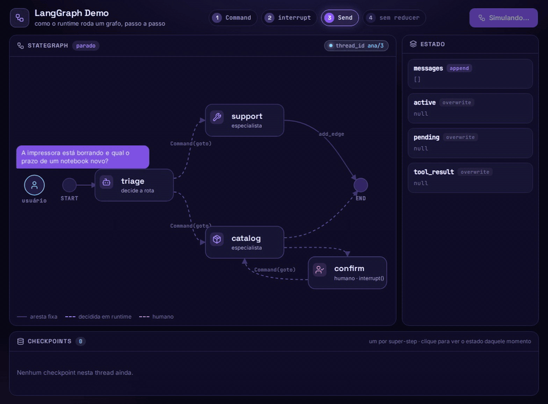

<div align="center">

# 🕸️ langgraph-demo

### A tiny service desk built as a graph, **drawn live** while a LangGraph-style runtime runs it: state and reducers, super-steps, a checkpoint per step, `Command`, `Send` and `interrupt()`, surviving a server crash.

<br />

[](https://langchain-ai.github.io/langgraph/)
[](#)
[](#-run-it)

<br />



</div>

---

## ✨ What it shows

One button, four chapters, about 90 seconds:

| # | The user says | What you watch |
|---|---|---|
| 1 · **Command** | *"Minha impressora está borrando"* | `triage` picks the next node itself with `Command(goto="support")`; a fixed edge takes `support` to `END` |
| 2 · **interrupt** | *"Quero o Adobe Acrobat Pro"* | `catalog` holds a write tool and routes to `confirm`, which calls `interrupt()`: the graph **pauses** and the pause is stored in the checkpoint. Then the server **crashes** — everything in memory is wiped — and comes back from the checkpoint alone, still waiting. The answer arrives as `Command(resume="sim")` and `confirm` runs **again from its first line**, this time with `interrupt()` returning the answer |
| 3 · **Send** | *"A impressora está borrando e qual o prazo de um notebook novo?"* | `triage` returns two `Send`; `support` and `catalog` run in the **same super-step** and the `append` reducer merges both answers |
| 4 · **no reducer** | same as 3 | `messages` loses its reducer: two writes in one super-step raise `InvalidUpdateError` — LangGraph refuses to pick a winner silently |

Around the graph:

- 💬 **The conversation lives in the drawing** — the message travels from the user to `START`, answers come back from `END`, the `interrupt` question goes to the user and the reply returns as `Command(resume)`
- 🧠 **State panel** — every channel with its reducer (`append` or `overwrite`), flashing on each write
- 💾 **Checkpoint tape** — one card per super-step (`step`, `source`, `next`); the paused one is marked. After the run, click any card to see the state at that moment (time travel)

## 🧩 The graph

```mermaid
flowchart LR
    U(["🧑 user"]) --> S((START)) --> T["🤖 triage"]
    T -. "Command(goto) · Send" .-> SUP["🔧 support"]
    T -. "Command(goto) · Send" .-> CAT["📦 catalog"]
    SUP --> E((END))
    CAT -.-> E
    CAT -. "Command(goto)" .-> C["✋ confirm · interrupt()"]
    C -. "Command(goto)" .-> CAT

    style T fill:#191736,stroke:#a78bfa
    style SUP fill:#191736,stroke:#a78bfa
    style CAT fill:#191736,stroke:#a78bfa
    style C fill:#2c1430,stroke:#f472b6
```



Solid = a fixed edge (`add_edge`). Dashed = decided at runtime by the node itself.

| Channel | Reducer | Holds |
|---|---|---|
| `messages` | `append` | the conversation |
| `active` | — (overwrite) | who is handling the request |
| `pending` | — | the write tool call waiting for confirmation |
| `tool_result` | — | the result of the confirmed call |

## 🐍 The same graph in real LangGraph

```python
import operator, sqlite3
from typing import Annotated, TypedDict
from langgraph.graph import StateGraph, START, END
from langgraph.types import Command, Send, interrupt
from langgraph.checkpoint.sqlite import SqliteSaver

class DeskState(TypedDict):
    messages: Annotated[list, operator.add]  # reducer: append
    active: str | None                       # no reducer: overwrite
    pending: dict | None
    tool_result: dict | None

def triage(state: DeskState) -> Command:
    ...  # the LLM decides; then:
    return Command(goto="support", update={"active": "support"})
    # two requests at once: Command(goto=[Send("support", {...}), Send("catalog", {...})])

def confirm(state: DeskState) -> Command:
    answer = interrupt({"question": "Posso abrir a solicitação do Adobe Acrobat Pro?"})  # pauses here
    # on resume this node runs again from the top and interrupt() returns the answer:
    # side effects go AFTER the interrupt
    ...

builder = StateGraph(DeskState)
for name, fn in [("triage", triage), ("support", support), ("catalog", catalog), ("confirm", confirm)]:
    builder.add_node(name, fn)
builder.add_edge(START, "triage")
builder.add_edge("support", END)
graph = builder.compile(checkpointer=SqliteSaver(sqlite3.connect("desk.db", check_same_thread=False)))

config = {"configurable": {"thread_id": "ana/2"}}
graph.invoke({"messages": [{"role": "user", "content": "Quero o Adobe Acrobat Pro"}]}, config)  # stops at interrupt
graph.invoke(Command(resume="sim"), config)  # continues, even from a brand-new process
```

## 🔬 How it is built

This is **not LangGraph running in the browser**. It is a ~250-line runtime that follows LangGraph's rules, small
enough to read in one sitting — the point is to *see* those rules:

- `js/engine.js` — the runtime: channels with reducers, super-steps (every task in a step reads the same snapshot),
  a checkpoint after each step, `Command`, `Send`, `interrupt()` with resume (the paused node re-runs from the top),
  `InvalidUpdateError`, and a checkpointer on `localStorage` — which is why the "crash" can wipe every object and
  still recover
- `js/desk.js` — the graph above. The "LLM" decisions are scripted keyword rules, so every run is identical
- `js/view.js` — the SVG graph, tokens and conversation bubbles; it knows nothing about the runtime
- `js/app.js` — turns runtime events into what you see, and plays the four chapters

Vanilla HTML/CSS/JS, no framework, no build step, [Lucide](https://lucide.dev) icons inlined as SVG.

## 🚀 Run it

Open `index.html` in a browser and press **Iniciar simulação**. That's it.

| URL flag | Effect |
|---|---|
| `?speed=2` | runs everything twice as fast |
| `?autoplay` | starts the simulation on load |

The layout is fixed at 1200px wide, so it records cleanly.

## 🔗 Related

- [mcp-protocol-demo](https://github.com/ganascimento/mcp-protocol-demo) — an agent discovering MCP servers and routing tool calls, drawn live
